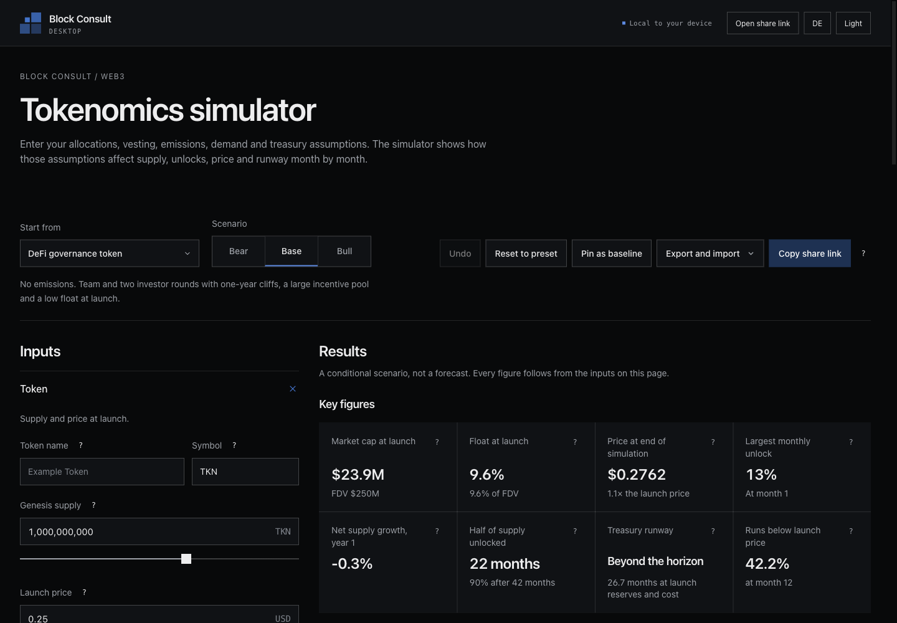
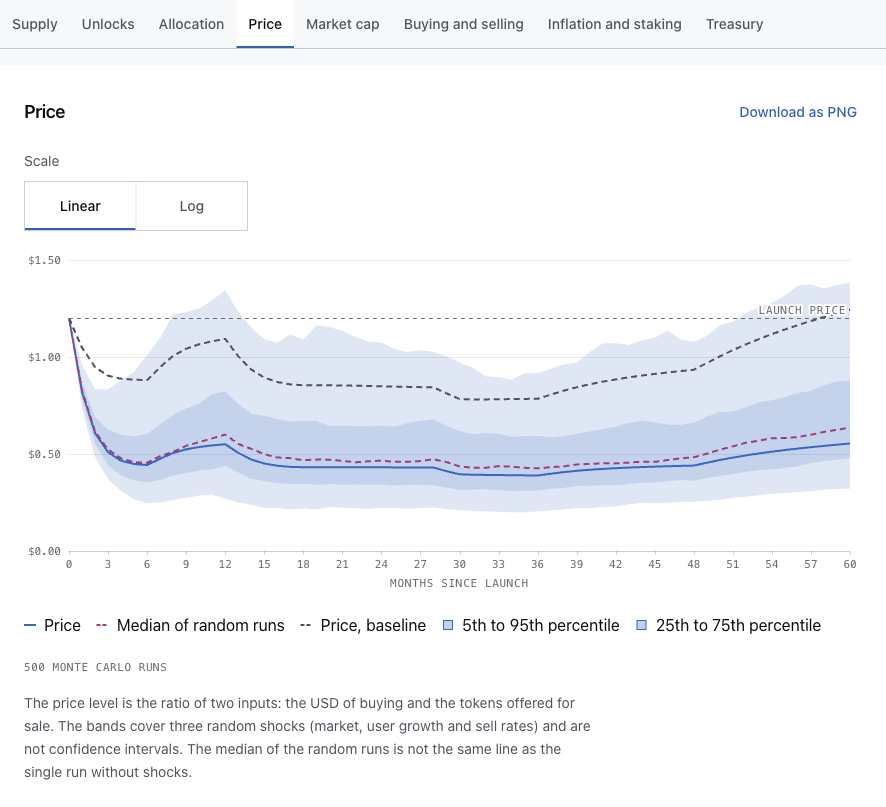

<a href="https://www.blockconsult.org">
  <picture>
    <source media="(prefers-color-scheme: dark)" srcset="public/blockconsult-logo.png">
    
  </picture>
</a>

# Tokenomics Simulator

Compare token designs month by month. Enter allocations, vesting, emissions, staking, demand and treasury costs, then inspect supply, unlocks, buying and selling, conditional price paths and treasury runway.

A local planning tool from [Block Consult](https://www.blockconsult.org), available for macOS, Windows and the browser in English and German. Calculations run on your device without an account or API key.

[](https://github.com/blockconsult-org/tokenomics-simulator/releases/latest) [](LICENSE) · [Platform builds](https://github.com/blockconsult-org/tokenomics-simulator/actions/workflows/release.yml)

**[Download for macOS or Windows](https://github.com/blockconsult-org/tokenomics-simulator/releases/latest)** · [Use in your browser](https://www.blockconsult.org/tokenomics-simulator) · [Report an issue](https://github.com/blockconsult-org/tokenomics-simulator/issues)



The desktop workspace keeps editable assumptions beside the model's results.

## What you can do

- Start from five generic token designs: DeFi governance, staking network, consumer or game token, DePIN, and fair launch.
- Set allocation shares, launch unlocks, cliffs and vesting schedules. Add fixed or inflationary emissions, supply caps, burns and staking assumptions.
- Inspect eight chart views, including supply, unlocks, price, buying and selling, and treasury balances; review holder outcomes and monthly data.
- Pin a baseline, change the assumptions and compare the resulting paths. Bear, base and bull settings change the speculative-demand scenario.
- Explore seeded Monte Carlo runs and threshold-based health checks, then export JSON, monthly CSV, chart PNGs or a PDF report.

Results are conditional scenarios. The model does not forecast a real token price, and its random-run bands are not confidence intervals. Market depth, demand and selling behavior are assumptions; review them before comparing designs.

## Get started

1. Choose a design under **Start from**, such as **Staking network**.
2. Edit the input sections for the token, allocations, emissions, demand and treasury. Review the key figures and health checks as you work.
3. Choose **Pin as baseline**, then change an assumption or select **Bear**, **Base** or **Bull**. Use the chart tabs to compare the outcomes.
4. Open **Export and import → Download model (JSON)** to keep a portable copy. Export monthly CSV or a chart PNG when you need the underlying figures or a visual.

## Screenshots



The fictional **Staking network** preset with a pinned base scenario, the bear scenario selected, and 500 seeded Monte Carlo runs. The chart displays model outputs, not expected market prices.

## Download and install

| Platform | Download | Installation |
| --- | --- | --- |
| macOS, Apple silicon and Intel | Universal `.dmg` | Open the disk image and drag the app to Applications. |
| Windows 11, Intel/AMD 64-bit | `windows-x64-setup.exe` | Run the per-user installer; administrator rights are not required. |
| Windows, portable | `windows-x64-portable.exe` | Run directly without installing. |

Release notes state the signing and notarization status of each download. Unsigned Windows releases may show a publisher warning. macOS requires macOS 13 or later. Check `SHA256SUMS.txt` against the downloaded file using `shasum -a 256` (macOS) or `Get-FileHash -Algorithm SHA256` (PowerShell). Download only from this repository's Releases page.

## Your data

- Calculations and editing work without an internet connection, account or API key.
- English/German UI, light/dark themes, keyboard controls and resizable layouts.
- Existing JSON models and browser share links remain compatible. Use **Open share link** to inspect a shared scenario locally.
- Exports use a native file-save dialog. **File → Save report as PDF** writes a local PDF.
- The current model saves automatically in this app's local profile when local storage is available. Download JSON copies for backups and versioning.
- No analytics, telemetry, cloud synchronization or automatic uploads. Website and evidence links open in your default browser. Unknown evidence destinations require confirmation.

Share links are readable, encoded snapshots, **not encrypted**. **Copy share link** includes the current model, including token and allocation names. Review those inputs before sharing. Opening a link replaces the model on screen; **Undo** brings back the previous inputs. Viewing a shared model leaves the local saved copy unchanged, while editing it makes it the model that autosaves. A pinned comparison baseline is not included in the model's JSON or share link.

## Run from source

Install Node.js 24 or newer, then:

```sh
git clone https://github.com/blockconsult-org/tokenomics-simulator.git
cd tokenomics-simulator
npm ci
npm run build
npm start
```

`npm run dev` runs the renderer in a browser. `npm test` checks the model and desktop security boundaries. `npm run test:desktop` launches real Electron and exercises offline rendering, themes, localization, exports and isolation. Run `npm run build` first.

```sh
npm run verify
npm run dist -- --mac --universal  # on macOS
npm run dist -- --win --x64       # on Windows
```

## Project layout

| Path | Responsibility |
| --- | --- |
| `simulator/` | Models, calculations, localized copy, UI and exports |
| `src/` | Desktop frame and small browser-framework adapters |
| `desktop/` | Sandboxed Electron host, local asset protocol, native PDF saving |
| `tests/` | Calculation regressions and real desktop integration checks |
| `.github/workflows/release.yml` | Tests and platform builds; draft releases for version tags |

## Release and maintenance

See the [release instructions](docs/RELEASING.md) for packaging and signing. Releases are manual downloads; the app does not silently update. Keep the Electron runtime current when maintaining a fork.

This tool supports token design and discussion. Results depend on the supplied assumptions and model limits; they are not financial, investment, legal or tax advice.

## Contributing and license

Read the [contribution guide](CONTRIBUTING.md) before opening a pull request. Report vulnerabilities through the process in the [security policy](SECURITY.md).

[MIT](LICENSE) · Copyright © 2026 Block Consult GmbH. The license covers the code; it does not grant rights to use Block Consult’s name or logo as an endorsement.
